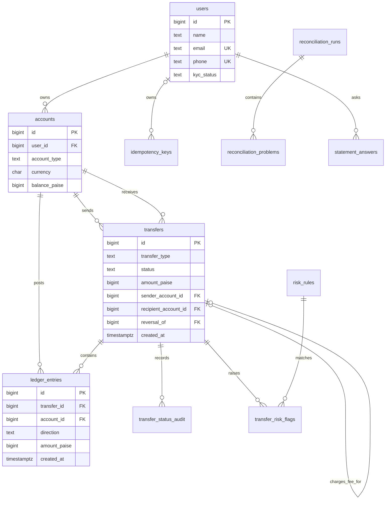

# Schema design

All primary keys are generated `BIGINT` identities. Table names are plural
snake_case; column names are singular. Money is integer paise. Debit/credit are
positive amounts with direction stored separately.

## Nouns: table or not?

| Noun | Stored as | Reason |
|---|---|---|
| User | `users` | Name, contact details, KYC status and identity |
| Wallet / system account | `accounts` | Common ledger target; system accounts have no user |
| Currency | `accounts.currency` | Requirement permits INR only, enforced by a check |
| Transfer | `transfers` | Immutable business event, type, status, amount, timing and reversal link |
| Debit/credit line | `ledger_entries` | Append-only record of every account movement |
| Idempotency key | `idempotency_keys` | Request hash and exact saved response for safe retry |
| Status change | `transfer_status_audit` | Database-triggered status history, actor and time |
| Fraud rule | `risk_rules` | Editable thresholds/actions instead of constants in Python |
| Fraud flag / explanation | `transfer_risk_flags` | Rule hit and optional model explanation/label |
| Reconciliation run | `reconciliation_runs` | Run timing, result and problem count |
| Reconciliation problem | `reconciliation_problems` | One row per observed mismatch |
| Job lock | `job_locks` | Single-row PostgreSQL lock per scheduled job |
| Statement answer | `statement_answers` | Saved question and verified response |
| Transfer sender/recipient | `transfers.sender_account_id`, `recipient_account_id` | Carries endpoints for direct, held, and settled transfers |
| System cash-in/cash-out/fee/hold | `accounts.account_type` | System accounts share the same ledger-account identity |
| Email/phone | `users.email`, `users.phone` | Externally controlled contact data; unique but not primary keys |
| Transfer note | `transfers.note` | Untrusted text attached to a money event; never used to build SQL |
| Balance | `accounts.balance_paise` | Cached for fast reads and compared to the ledger nightly |
| Audit actor | `transfer_status_audit.changed_by` | Text because an actor can be a user, admin, or system process |

The database enforces positive entry amounts, one INR currency, non-negative
wallet balances, immutable entries, uniqueness of idempotency keys, and
per-transfer balanced entries at transaction commit. System-account balances can
be negative. Reversals are new transfers; existing entries are never rewritten.

## Cardinality decisions

- A user has zero or many accounts; each wallet has exactly one owning user.
- System accounts have no user. There is one account for each system account type, including the hold-clearing account.
- An account has zero or many ledger entries; each entry belongs to one account.
- Every committed transfer has at least two ledger entries. A direct transfer has a debit and credit. A held transfer first debits the sender and credits the hold account; release or rejection adds the hold debit and final credit, preserving the original reservation audit trail.
- Each transfer identifies one sender and recipient account. A held transfer has these references and reservation ledger entries before it is decided.
- A transfer may be reversed once; the reversal references the original transfer.
- A transfer has zero or many risk flags; each flag identifies one configured rule.
- A rule can flag many transfers.
- A transfer has one or many status audit events; the database records each creation/status transition.
- A reconciliation run has zero or many problems.
- Each idempotency key row belongs to at most one user; `(user_id, key)` is unique. Anonymous user-creation/admin keys have their own unique null-user namespace.
- A user has zero or many saved statement answers.

## ER diagram

## Migration

`migrations/001_init.sql` builds the base schema and initial system accounts
from an empty PostgreSQL database. `migrations/002_fee_and_hold_accounts.sql`
adds the fee relationship and hold account, updates the deferred ledger
constraints, and safely reserves eligible legacy held transfers. Compose runs
both scripts for a fresh volume and has a migration service for existing
volumes. PostgreSQL's `docker-entrypoint-initdb.d` scripts run only on an empty
data volume.
